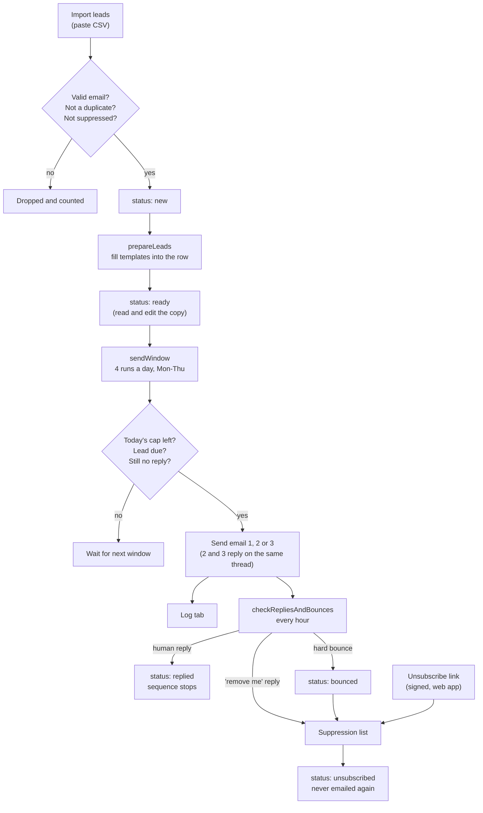

# Cold email sequencing that respects caps, replies and unsubscribes: Google Sheets + Apps Script, no paid tool

Leads live in a Google Sheet. Apps Script writes a three-email sequence into each lead's row, sends it from your own Gmail on a day 0 / +3 / +6 cadence, stops the moment someone replies, bounces or opts out, and logs every step to a Log tab.

This is a generic, cleaned-up version of a sequencer I built for my own consulting outbound. Every name, address and email in this repo is a placeholder or fake.

Nothing sends until you set `DRY_RUN` to `false`, and even then the script refuses to send while the sender details are still placeholders or the unsubscribe page is not deployed.

## How it flows



## What works

| Feature | How |
|---|---|
| Daily cap with a warmup ramp | 10, 20, 30, 40 a day for weeks 1 to 4, then `DAILY_CAP_MAX` (50). New sends and follow-ups share the cap. |
| Pacing | The cap is split across four send windows (9, 11, 13, 15h), with a random 5 to 20 second pause between sends. Sends only on `SEND_DAYS` (Mon to Thu by default). |
| 3-touch cadence | Email 1 on day 0, email 2 three calendar days later, email 3 three days after email 2. Follow-ups go before new sends when the cap is tight. |
| Threading | Emails 2 and 3 are replies on the email 1 thread, so the prospect sees one conversation. |
| Stop on reply | Hourly check of each lead's thread, plus a second check right before any follow-up goes out. Out-of-office replies and bounce notices do not count as replies. |
| Unsubscribe link | Every email footer links to a web app in the same script. The link is signed (HMAC-SHA256), so nobody can opt out other people by guessing links. |
| Suppression list | A Suppression tab. Unsubscribes, hard bounces and "please remove me" replies land there. Suppressed addresses are skipped at import, at prepare time and at send time. You can add addresses by hand. |
| Bounce check | Reads delivery-failure notices from the last three days. Hard bounces mark the lead `bounced` and suppress the address. Soft bounces (mailbox full, try again later) are ignored. |
| Personalisation | `{{firstName}}`, `{{company}}`, `{{personalLine}}` and more, with fallbacks: `{{firstName\|there}}`. A lead with a required field empty is not prepared, so "Hi {{firstName}}" never reaches an inbox. |
| Dry run | `DRY_RUN: true` logs every email it would send and changes nothing on the Leads tab. |
| Logging | Every import, prepare, send, skip, block, reply, bounce and unsubscribe is a row on the Log tab. |
| Fail closed | Live sending is blocked while `FROM_NAME`, `SENDER_COMPANY`, `REPLY_TO`, `PHYSICAL_ADDRESS` or `RAMP_START_DATE` is unset, or the unsubscribe page is not deployed. The reason shows on the Log tab and in Outreach > Show status. |

### What I dropped from the original

- **AI-written copy.** The original called an LLM API to write each lead's three emails from research notes. This version uses templates instead. It needs no API key, costs nothing to run, and the output is predictable and testable. The `Personal Line` column is where per-lead research goes now: you write one sentence, the template does the rest.
- **Settings on a Config tab.** Settings now live in `src/Config.gs`, so the repo shows every setting in one file. The trade-off: changing a setting means editing the script, not the sheet.

## Sheet columns

`setupWorkbook()` creates three tabs.

**Leads** (one row per lead):

| Column | Filled by | Notes |
|---|---|---|
| ID | import | |
| Status | script | `new`, `ready`, `in_sequence`, `completed`, `replied`, `bounced`, `unsubscribed`, `invalid` |
| First Name, Last Name, Email, Company, Website, City, Industry | you | Only Email is required at import. The shipped templates also need Company. |
| Personal Line | you | One true, specific sentence about this lead. Leave blank to use the template's fallback. |
| Source | you | Where the lead came from. |
| Date Added | import | |
| Email 1-3 Subject, Email 1-3 Body | prepare | Edit freely. The sender uses what is in the row. |
| Email 1-3 Sent | send | Timestamps. These drive the cadence and the daily count. |
| Thread ID | send | Gmail thread for follow-ups and reply checks. |
| Replied, Bounced, Unsubscribed | monitor | Timestamps. |
| Notes | script | Why a lead was skipped or a send failed. |

**Suppression**: Email, Reason, Added At. **Log**: Timestamp, Email, Step, Result, Detail.

[`sample-sheet.csv`](sample-sheet.csv) has 10 fake leads with the import columns. Headers are matched by name, and common variants (`Email Address`, `Organisation`, `Notes`) work too: see `HEADER_ALIASES` in [`src/Core.js`](src/Core.js).

## Setup

You need a Google account with Gmail. A Workspace account on your own domain is better for deliverability; set up SPF, DKIM and DMARC for it before you send anything.

### Option A: copy and paste

1. Create a Google Sheet. Open Extensions > Apps Script.
2. Delete `Code.gs`. For each file in `src/`, create a file with the same name and paste the contents in. `Core.js` becomes `Core.gs`; that is fine.
3. Open Project Settings and tick "Show appsscript.json". Paste in `src/appsscript.json` and set `timeZone` to your sheet's timezone (File > Settings in the sheet).
4. Leave `SHEET_ID` as the placeholder. A script bound to the sheet uses the active spreadsheet.

### Option B: clasp

```bash
npm install -g @google/clasp
clasp login
clasp create --type sheets --title "Outbound sequencer" --rootDir src
clasp push
```

`clasp create` writes `.clasp.json` with your script ID; it is in `.gitignore`. To push to an existing script instead, copy `.clasp.json.example` to `.clasp.json` and put your script ID in it. If the script is not bound to the sheet, set `SHEET_ID` in `Config.gs`.

### Then, either way

1. Reload the sheet. An **Outreach** menu appears. Run **1. Set up workbook** and approve the permissions.
2. Fill in the `YOUR_...` values in `Config.gs` and set `RAMP_START_DATE` to your first send day.
3. Deploy > New deployment > Web app. Execute as: Me. Who has access: Anyone. Then run `captureWebAppUrl` once from the editor. This turns on the unsubscribe links.
4. Run **2. Install triggers**.
5. Import leads (Outreach > Import leads), then Outreach > Write copy for new leads. Read the copy on the Leads tab.
6. Watch a day of dry-run entries on the Log tab. When you are happy, set `DRY_RUN: false`.

To stop everything, set `DRY_RUN` back to `true` or run Outreach > Remove all triggers. Leads keep their place in the sequence.

## Tests

The rules that matter (who is due today, how many may go out, what the email says, what counts as a reply or a bounce) live in [`src/Core.js`](src/Core.js) as plain functions with no Apps Script calls. The `.gs` files call them. Node runs the same file:

```bash
npm test
```

25 tests cover the cadence, caps and pacing, template filling (including a check that the shipped templates fill cleanly for every row of the sample CSV), reply and bounce rules, and opt-out detection. Node 18 or newer, no dependencies.

The Apps Script side (sheet reads and writes, Gmail calls, triggers) has no automated tests here.

## Safety rules

- **Caps.** Do not raise `DAILY_CAP_MAX` above 50 on one inbox, and do not skip the ramp on a new domain. If you need more volume, add inboxes, not cap.
- **Unsubscribe.** Every email carries a working opt-out and your postal address. Opt-outs are permanent: the suppression list blocks re-import.
- **Stop on reply.** Any human reply ends the sequence for that lead. Read and answer replies yourself.
- **Bounces.** Verify emails before import. If hard bounces pass about 3% of sends, stop and clean the list.
- **Check your local email law before sending.** South Africa's POPIA, the US CAN-SPAM Act and the EU and UK GDPR (with PECR in the UK) set different rules for cold email, and some countries (Canada's CASL, for example) require consent first. The footer and opt-out here cover the common baseline, not every rule. This is not legal advice.

## Limits

- **Gmail sending limits.** Apps Script can send roughly 100 emails a day on a free account and roughly 1,500 on Workspace. The cap of 50 sits well under both.
- **No open or click tracking.** On purpose: tracking pixels and rewritten links hurt deliverability. Replies are the metric.
- **No `List-Unsubscribe` header.** GmailApp cannot set custom headers, so there is no one-click unsubscribe button in the recipient's mail client. The footer link is the opt-out. Bulk senders to Gmail and Yahoo addresses are required to have that header; at 50 a day you are far below their bulk threshold, but it is a real gap.
- **Bounce matching reads notice text.** Unusual bounce formats can be missed. Check the Log and add addresses to Suppression by hand when that happens.
- **Out-of-office detection is by subject only.** An auto-reply with an unusual subject counts as a reply and stops the sequence. That errs on the safe side.
- **Trigger timing is loose.** Apps Script runs an hourly trigger some time within that hour, not on the minute.
- **One inbox, one sheet.** Past a few thousand rows, sheet reads get slow and the 6-minute run limit gets close.
- **Plain text only.** No HTML templates, no A/B tests.

## When to use a paid tool instead

Use a dedicated sequencing tool when you need several sending inboxes with rotation, automated inbox warmup, a `List-Unsubscribe` header, A/B tests on copy, reply classification across a team, or CRM sync. Same if more than one person works the replies, or you send more than a few hundred emails a day. This sheet is for one person sending a careful, low-volume sequence, who wants to see every email before it goes out and pay nothing to do it.

## Files

| File | What it does |
|---|---|
| `src/Core.js` | Pure logic: cadence, caps, pacing, templates, reply and bounce rules, header mapping. Tested with Node. |
| `src/Config.gs` | Settings (placeholders), sheet layout, shared helpers. |
| `src/Templates.gs` | The three example emails for a fictional invoice-reminder SaaS. |
| `src/Sequencer.gs` | `prepareLeads` and `sendWindow`. |
| `src/Monitor.gs` | Reply and bounce checks, suppression list. |
| `src/Unsubscribe.gs` | Signed opt-out links and the web app page. |
| `src/Leads.gs` | Import dialog. |
| `src/Setup.gs` | Menu, workbook setup, triggers, status. |
| `test/core.test.js` | Node tests for `Core.js`. |
| `sample-sheet.csv` | 10 fake leads. |


---

**More from me:** [Portfolio and case study](https://rynojor.github.io) · [Revenue Leak Engine](https://github.com/RynoJor/revenue-leak-engine) (the flagship project, with a live dashboard) · [LinkedIn](https://www.linkedin.com/in/ryno-jordaan/)

Built by Ryno Jordaan, GTM engineer.
